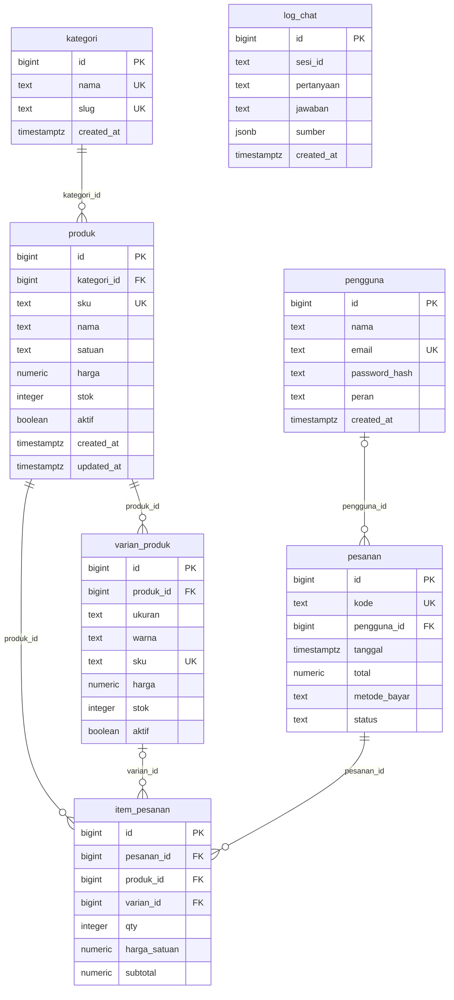

# ERD — StationeryIQ (Toko Anugerah)

Sumber kebenaran: [`db/schema.sql`](../db/schema.sql). Diagram di bawah ikut berubah
saat skema berubah — perbarui file ini di PR yang sama.

`log_chat` tidak punya relasi FK (`sesi_id` teks bebas). View `products`
(lihat `schema.sql`) menyajikan `{id, nama, kategori, stok, harga, satuan}`
sebagai bentuk baca yang dipakai backend.

